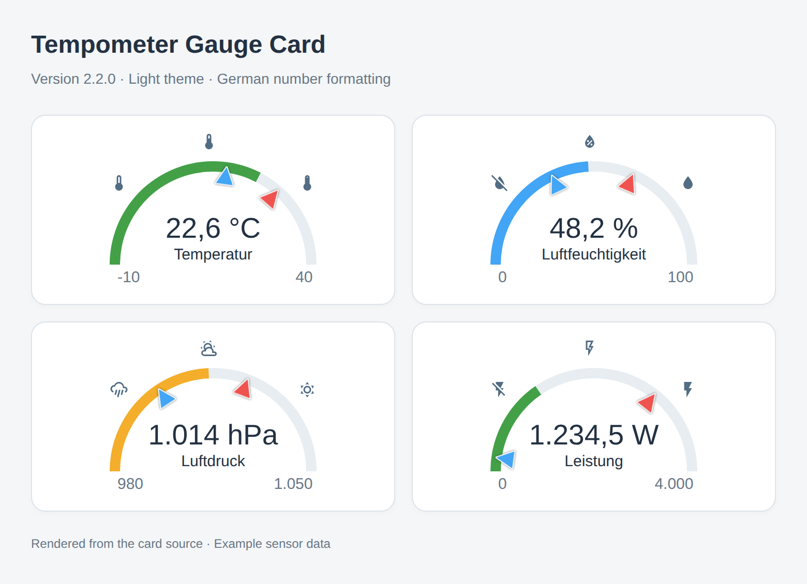
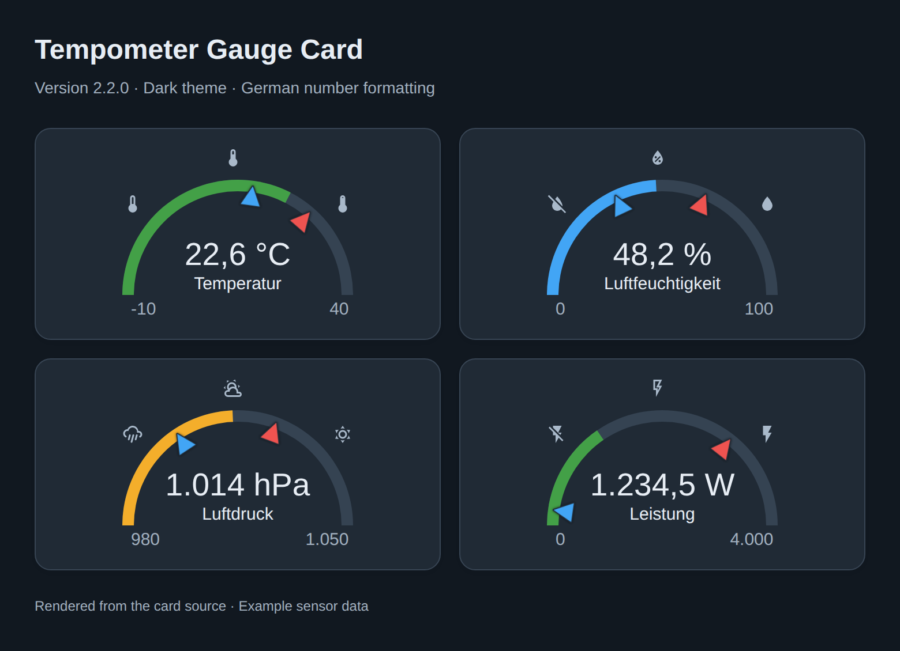
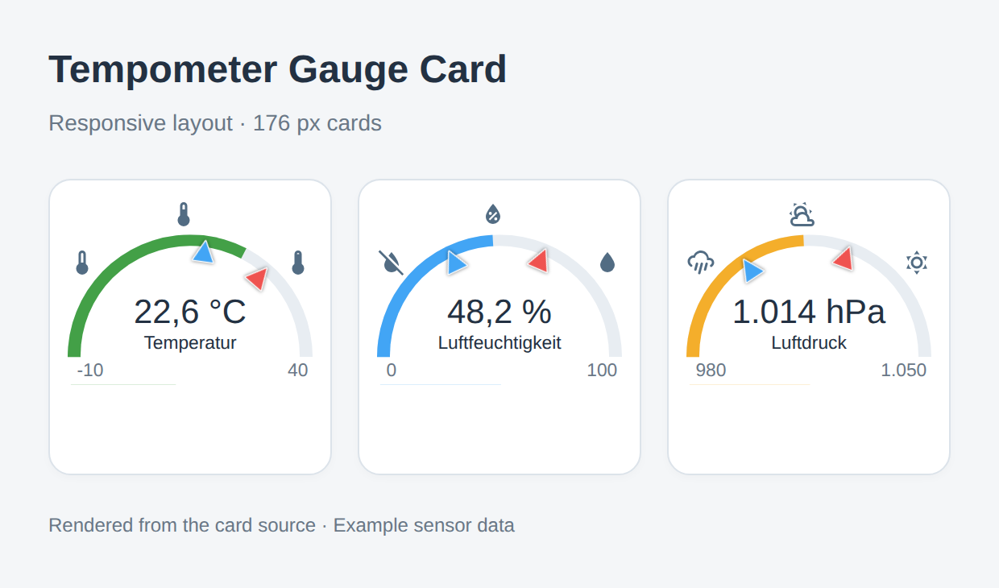

# Tempometer Gauge Card

A Home Assistant dashboard gauge for temperature, humidity, air pressure and other numeric sensors. Version **2.2.0** adds responsive sizing, native visual configuration, theme-aware colors and localized numbers.

Compatibility target: **Home Assistant 2026.10.1**, as of 2026-10-13. The minimum remains **2026.3.2**. Automated logic and Chromium checks pass; runtime integration with a running Home Assistant installation still needs verification.

## Previews

The current card rendered with example sensors, German number formatting and min/max markers:

| Light theme | Dark theme |
| --- | --- |
|  |  |

Responsive layout in narrow cards:



These images are generated from `tempometer-gauge-card.js` in Chromium using sample data, Material Design Icons and minimal HA surface components. They illustrate the card; they are not screenshots of a running Home Assistant installation.

## Installation

Install through HACS if this repository is available there, or copy `tempometer-gauge-card.js` to `<config>/www/lovelace/` and register a dashboard resource:

```yaml
resources:
  - url: /local/lovelace/tempometer-gauge-card.js?v=2.2.0
    type: module
```

For dashboards managed through the UI, add the same URL under **Settings → Dashboards → Resources**, selecting **JavaScript Module**. Use the HACS-provided URL when installing through HACS.

After updating, refresh the resource URL version and reload the dashboard. The card has no runtime dependencies and needs no build step.

## Quick start

Add **Tempometer Gauge Card** from the dashboard card picker, then configure it in the visual editor. Home Assistant provides a live card preview beside the editor. Entity selectors, bounds, styles, units, precision, icons, severity thresholds and display settings are available there.

For an entity attribute, use the YAML editor and append the attribute to the entity ID, for example `sensor.weather.temperature`. Existing YAML options are preserved when changing supported fields in the visual editor.

```yaml
type: custom:tempometer-gauge-card
entity: sensor.temperature
min: 0
max: 40
title: Temperature
card_style: thermometer
decimals: 1
```

## Layout and interaction

The gauge automatically shrinks to fit its parent with 12 px space on either side. It works in Sections, grids and horizontal stacks. The default Sections footprint is 6 columns × 3 rows; at least 4 columns and 3 rows are recommended. The default card height is 184 px. Larger explicit scales can need more rows.

`scale` sets the maximum gauge size: `50px` produces a 200 px wide gauge, and `40px` produces a 160 px wide gauge. Set `responsive: false` to keep the exact configured gauge size; it may overflow a narrow parent. The legacy `horizontal: true` selects `40px`.

Click the card, or focus it with Tab and press Enter or Space, to open the entity's more-info dialog. Keyboard focus is visible. Min/max markers are filled blue/red triangles with a contrasting outline; their tips align with the gauge arc, including in narrow cards. They have hover tooltips with their formatted values and unit. Long values and titles are truncated to fit.

Animations automatically respect the operating system's **Reduce motion** preference. Set `animation: false` to disable them regardless of that preference.

## Options

| Option | Type | Default / behavior |
| --- | --- | --- |
| `entity` | string, required | Entity ID, optionally followed by `.attribute`. |
| `min` | number, required | Finite minimum of the gauge scale. |
| `max` | number, required | Finite maximum, strictly greater than `min`. |
| `title` | string | Optional title. |
| `card_style` | string | `barometer`, `thermometer`, `humidity` or `custom`; defaults to barometer. |
| `entity_min` | string | Optional entity or attribute for the recorded minimum marker. |
| `entity_max` | string | Optional entity or attribute for the recorded maximum marker. |
| `measurement` | string | Override the entity's unit; `""` hides the unit. |
| `decimals` | integer | 0–20 decimal places; otherwise retain numeric precision. |
| `scale` | CSS length string | Maximum base size, default `50px`. Pixel lengths are recommended for accurate height reporting. |
| `horizontal` | boolean | Legacy compact sizing; overrides `scale` with `40px`. |
| `responsive` | boolean | `true`: shrink the gauge to fit narrow parents. |
| `localize` | boolean | `true`: use Home Assistant's number-format preference. `false`: ungrouped numbers with decimal points. |
| `locale` | string | Optional locale override, e.g. `de-DE`. Takes precedence over HA preferences when localization is enabled. |
| `animation` | boolean | `true`: animate gauge and marker positions, unless reduced motion is requested. |
| `icon1`, `icon2`, `icon3` | string | Left, center and right MDI icons for `custom` style. |
| `icon_color` | CSS color string | Optional icon color override. |
| `severity` | object | Color thresholds described below. |

Min/max history is **not calculated by this card**. Supply sensors that record it, for example helpers or statistics sensors. Missing, empty or nonnumeric readings display `unavailable`; `unknown` is shown explicitly. Invalid main readings hide the gauge fill and markers. Invalid min/max readings hide only their respective marker.

Values outside the configured scale keep their actual displayed value; gauge and marker positions stop at the scale endpoints.

### Severity and theme colors

Supply all three numeric thresholds `green`, `yellow` and `red`. Thresholds are sorted numerically, so ascending and descending color orders are supported. Each threshold's color applies until the next threshold. Below the first threshold the normal color applies. Optional `max` caps the last colored interval; at and above that upper limit the normal color applies. Set `max` above every color threshold.

```yaml
severity:
  green: 22
  yellow: 24
  red: 27
  max: 40
```

The gauge uses HA theme colors `--success-color`, `--warning-color`, `--error-color` and `--info-color`. Minimum and maximum markers use info and error colors. Icons use `--state-icon-color`; bound labels use `--secondary-text-color`. Legacy color variables and built-in colors provide fallbacks. Theme changes update the colors without editing the card.

### Localized numbers

With `localize: true`, the card follows the HA language and number format settings, including decimal-comma, decimal-point, Swiss and ungrouped formats. It formats the value, scale labels and marker tooltips consistently. `decimals` preserves the specified number of trailing zeroes.

```yaml
type: custom:tempometer-gauge-card
entity: sensor.temperature
min: -10
max: 40
card_style: thermometer
decimals: 2
locale: de-DE
# A reading of 21.5 is displayed as 21,50 °C when the sensor unit is °C.
```

## Examples

### Air pressure with history markers

```yaml
type: custom:tempometer-gauge-card
entity: sensor.barometer
min: 980
max: 1050
entity_min: sensor.barometer_min_this_week
entity_max: sensor.barometer_max_this_week
title: Barometer
decimals: 0
severity:
  red: 980
  yellow: 1000
  green: 1020
```

### Compact humidity card without animations

```yaml
type: custom:tempometer-gauge-card
entity: sensor.humidity
min: 0
max: 100
title: Humidity
card_style: humidity
scale: 40px
responsive: true
animation: false
decimals: 0
```

### Custom power gauge

```yaml
type: custom:tempometer-gauge-card
entity: sensor.power
min: 0
max: 4000
title: Power
card_style: custom
icon1: mdi:flash-off
icon2: mdi:flash-outline
icon3: mdi:flash
severity:
  green: 1000
  yellow: 2000
  red: 3000
  max: 5000
```

## Changes

### 2.2.0

- Responsive sizing for narrow grids and stacks.
- Theme-aware gauge, marker, icon and label colors with fallbacks.
- Localized readings, scale labels and marker tooltips.
- Keyboard activation, accessible card label and visible focus.
- Native `ha-form` visual editor with entity/icon selectors and dashboard live preview.
- Reduced-motion support and an explicit animation toggle.

### 2.1.0

- HA states-context subscription, with cleanup and legacy `hass` fallback.
- Robust unavailable readings, configuration refresh and clamped marker positions.
- Configuration validation and corrected Masonry/Sections sizing.
- Module resource installation.

## Development and verification

Node.js 20 or newer:

```sh
npm test
npm run check
```

Optional real-browser checks require Playwright and Chromium:

```sh
npm install --no-save playwright
npx playwright install chromium
npm run test:browser
```

`CHROMIUM_PATH` can point to an existing Chromium executable. Browser checks exercise responsive sizing, theme colors, reduced motion, keyboard activation and focus with minimal HA surface styles. They do not replace testing HA's real `ha-card`, icons, selectors and live preview.

Before releasing, verify the visual editor and YAML round trip in Home Assistant 2026.10.1, narrow and full-width layouts, light/dark themes, language preferences, unavailable readings, attribute sensors and history markers.

Regenerate the README previews with the same optional Playwright setup:

```sh
npm run previews
```

The preview script downloads pinned [Material Design Icons](https://github.com/Templarian/MaterialDesign) SVGs (Apache-2.0), so regeneration needs internet access. Generated PNGs are stored in `docs/previews/` and should be included in commits. The script also supports `CHROMIUM_PATH`.

Frontend integration follows the [Home Assistant custom-card API](https://developers.home-assistant.io/docs/frontend/custom-ui/custom-card/).
